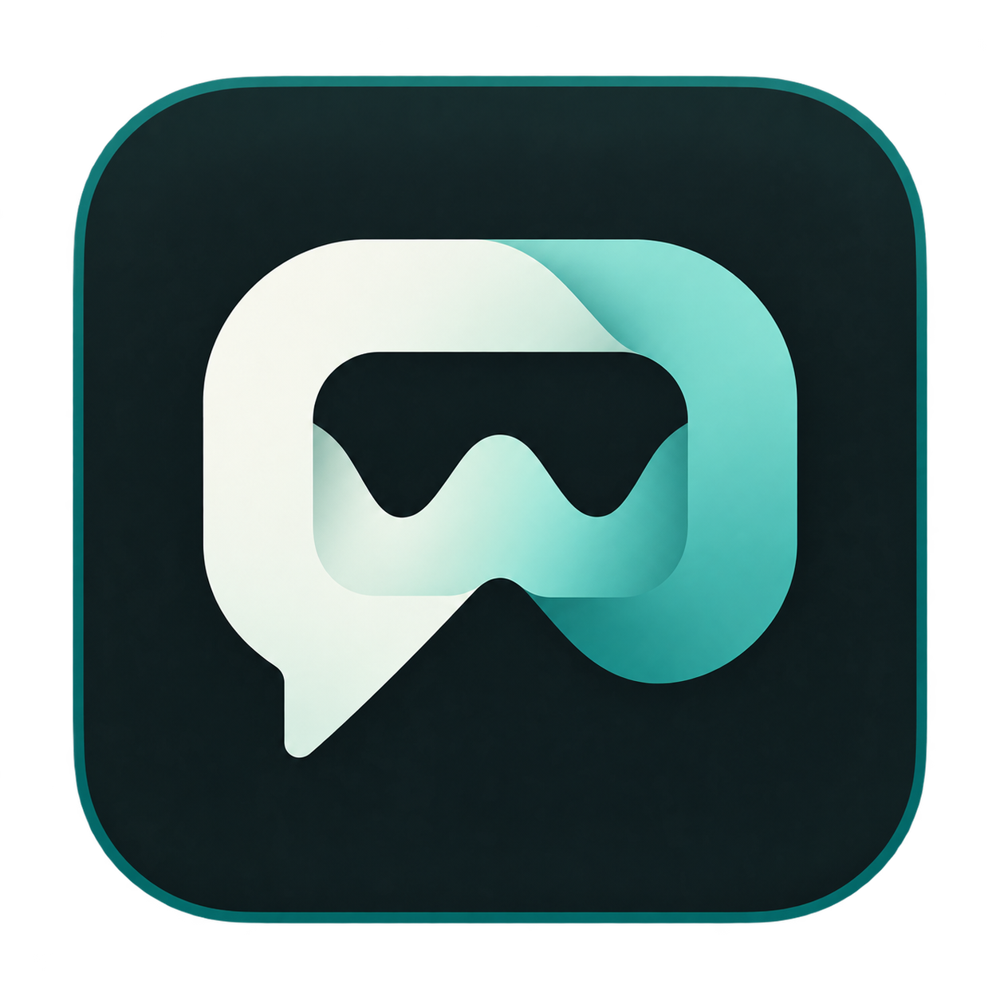
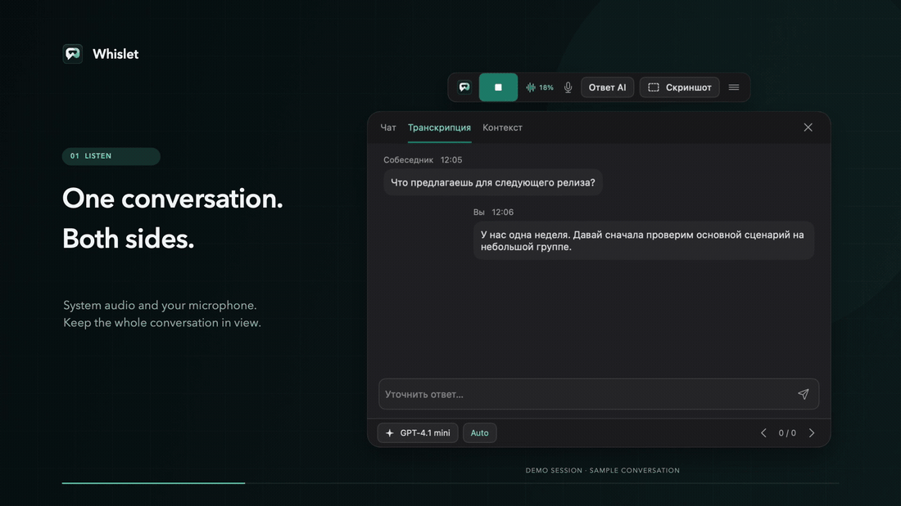

# Whislet

A real-time copilot for your calls, built for macOS.

Whislet listens to the conversation and brings useful context into a small floating panel. Get a suggested reply, explain a concept or check a detail without leaving your call. Add your own notes to keep suggestions relevant to team syncs, project discussions, client conversations and brainstorming.

[](Media/whislet-demo.mp4)

[Watch the demo](Media/whislet-demo.mp4) · [View the interface](Resources/Preview.png)

Recorded from the native interface with a fictional demo conversation.

## Features

- Listen to both system audio and your microphone, with local Qwen3-ASR recognition on Apple Silicon.
- Request a suggestion yourself or let automatic question detection prompt one.
- Translate the latest speaker's words into Russian on demand, alongside your suggested reply.
- Keep separate context profiles for different conversations.
- Include screen context when needed; read compact Markdown and highlighted code.
- Use your own OpenAI-compatible API key, Base URL and model ID.
- Keep controls and answers together in a movable panel with global shortcuts.

## Build and run

Requires Apple Silicon, macOS 15.5+, Xcode Command Line Tools with Swift 6.1+, and Python 3.11+.

```sh
git clone https://github.com/F5ve-leaFCloveR/ai-copilot-whislet.git
cd ai-copilot-whislet
bash scripts/setup-asr.sh
bash scripts/build-app.sh
open dist/Whislet.app
```

Keep the app in `dist/` within the checkout: it resolves the local Python environment relative to that location. ASR setup installs pinned packages, reuses cached weights and downloads missing models. Environments and model weights stay outside Git. See [local ASR setup](sidecar/README.md).

Allow microphone and screen/system-audio access on the first launch. An optional persistent local signing identity avoids changing the signature on every rebuild:

```sh
bash scripts/sign-app.sh --setup
bash scripts/build-app.sh
```

Without that identity, builds use an ad-hoc signature. This is a source-build project; the app is not notarized.

## Connect your model

Open **Settings → General → API**, enter a key and choose a model. The key is stored in macOS Keychain.

| Connection | Base URL | Example model ID |
| --- | --- | --- |
| OpenAI | `https://api.openai.com/v1` | `gpt-4.1-mini` |
| OpenRouter | `https://openrouter.ai/api/v1` | `openai/gpt-4.1-mini` |
| Custom | Your API root, such as `https://example.com/v1` | Exact ID supplied by that service |

An empty Base URL enables automatic detection of known key formats. An explicit URL takes precedence. Keys are sent only to the configured origin. HTTPS is required; HTTP is allowed for local loopback servers.

Use the provider's exact model ID. Disable JSON Schema if the model or endpoint does not support it; structured hints still require valid JSON. Screen questions require a vision-capable model. Parameter support depends on your provider.

Whislet streams Chat Completions responses. Providers without a balance endpoint can start normally. Reported USD and RUB costs are separate; unavailable cost is shown as unknown. Configure spending limits with your provider.

## Profiles and controls

New profiles have empty context. Add project notes, meeting goals or other background in the app.

**AI answer** uses the latest recognized speech from either source. An unfinished utterance waits up to two seconds for final text, then uses the latest partial. **Auto** reacts to completed questions from system audio. Hide continues listening; pause stops capture. Ending a session clears the temporary conversation.

**Translate** uses the latest recognized system-audio utterance and shows a separate Russian translation. Use the toolbar icon, the answer panel's **Перевод** button or Control + Option + T. Translation runs independently of reply generation and sends only the source text to your configured model, without profile notes, conversation history or screenshots.

| Shortcut | Action |
| --- | --- |
| Control + Option + H | Answer / show answer panel |
| Control + Option + T | Translate the latest speaker's words into Russian |
| Control + Option + S | Answer with screenshot |
| Control + Option + X | Hide windows |
| Control + Option + P | Pause / resume |
| Control + Option + B | Previous hint |
| Control + Option + N | Latest hint |

Shortcuts are configurable. The current UI is in Russian; recognition supports Russian and English.

## Privacy and storage

Speech recognition is local. Raw audio is not uploaded to a transcription service or saved by default. The selected chat provider receives the question, bounded conversation context, supplied profile and requested screen context.

API requests use an ephemeral, non-caching session. Transcripts and answer history are temporary; there is no durable session archive. Cost and capture-check reports do not contain conversation text. Explicit evaluation runs may save outputs in private local reports.

For compatibility with earlier installations, local data uses `~/Library/Application Support/InterviewCopilot`, and the bundle identifier remains `local.interviewcopilot`. Those files and Keychain items are not part of this repository.

Window content protection and a local capture check are available. Screen-sharing behavior depends on macOS and the conferencing application; verify each service and mode from a second device. Use recording and assistance where participants and applicable rules permit them.

## Development

```sh
bash scripts/swift-env.sh swift test
sidecar/.venv/bin/python -m unittest discover -s Tests -p '*Tests.py'
sidecar/.venv/bin/python -m unittest discover -s sidecar/tests
```

- `Sources/CopilotCore`: prompts, provider compatibility, streaming, state and context selection.
- `Sources/InterviewCopilot`: panels, capture, permissions, Keychain and ASR integration.
- `sidecar`: local recognizer, VAD and Unix-socket protocol.
- `Tests`: fictional fixtures and transport/UI regression tests.

Personal profiles, recordings, real-call fixtures, signing material, environments, model weights and local evaluation reports are excluded. No real biography or corporate project knowledge is bundled.

## License

MIT for the application code. Dependencies and model weights retain their own licenses.
